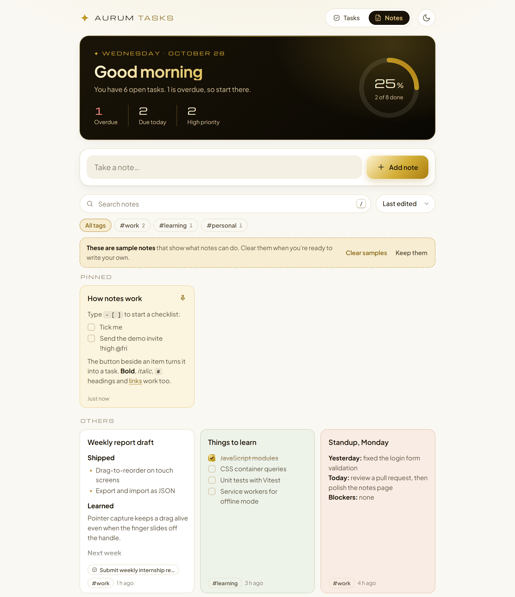

# Aurum Tasks

A clean, gold-accented todo list and notebook built with plain HTML, CSS and JavaScript. No framework and no build step, so it deploys straight to GitHub Pages.




**Live demo:** <https://imainzed5.github.io/aurum-tasks/>

## Features

- **Tasks:** add, edit, complete and delete, with Undo after deleting or clearing
- **Quick-add syntax:** type `Send report #work !high @fri` and the tag, priority and due date fill themselves in
- **Priorities, due dates and tags**, with overdue tasks in red and today's tasks in amber
- **Filters:** All / Active / Done, one-click tag chips, live search, and four sort orders
- **Drag to reorder** with a mouse or on a touch screen, plus arrow keys for keyboard users
- **Notes:** a second view (the Tasks / Notes switch at the top) with note cards that save as you type
- **Checklists and Markdown in notes:** tick items right on a card, and turn any open item into a task with one click
- **Pin and colour notes**, tag and search them, and link a note to a task (the task row shows a chip that opens it)
- **Daily summary:** greeting, progress ring, and counts for overdue, due today and high priority
- **Light and dark themes**, remembered between visits
- **Export / import** your tasks and notes as one JSON file for backup or moving to another browser
- **Saves automatically** in the browser (localStorage) and stays in sync across open tabs
- **Responsive and accessible:** works on phones, labelled for screen readers, visible focus states, respects reduced motion

## Quick-add syntax

| Type in the title | What it does |
| --- | --- |
| `#work` | Adds the tag "work" (use as many as you like) |
| `!high`, `!med`, `!low` (or `!h`, `!m`, `!l`) | Sets the priority |
| `@today`, `@tomorrow` (`@tmr`) | Sets the due date |
| `@mon` … `@sun`, `@friday` | Due on the next one of that weekday |
| `@nextweek` | Due 7 days from today |

## Writing notes

Notes understand a small, safe subset of Markdown. It is turned into page elements directly (never `innerHTML`), so nothing typed in a note can become markup.

| Type in a note | What you get |
| --- | --- |
| `- [ ] item` / `- [x] item` | A checklist item you can tick on the card |
| `- item` or `1. item` | Bullet or numbered list |
| `# Title`, `## Section`, `### Label` | Headings |
| `**bold**`, `*italic*`, `~~strike~~`, `` `code` `` | Inline styles |
| `[text](https://…)` or a bare `https://` link | Links (open in a new tab) |
| `> quote`, `---` | Quote, divider |

The button beside an open checklist item moves it to the task list. Quick-add words still work there, so `- [ ] Send invite !high @fri` becomes a high-priority task due Friday, and the task also gets the note's tags. **Undo** puts it back.

## Keyboard shortcuts

| Key | Action |
| --- | --- |
| `N` | Jump to the new-task (or new-note) box |
| `/` | Jump to search |
| `Enter` in a note title | Move on to the note text |
| `Ctrl` + `Enter` | Add the note, or close the note dialog |
| `Esc` | Clear search / leave a field |
| `↑` `↓` on a task's handle | Move the task up or down |
| Double-click a task | Edit it |

## Project structure

```
aurum-tasks/
├── index.html        Page layout, the task row and note card templates, both dialogs
├── css/
│   └── style.css     Design tokens (colours, fonts) and all styles, light + dark
├── js/
│   ├── app.js        Entry point: wires clicks, keys and drag-and-drop to the store
│   ├── store.js      State for tasks and notes, saving to localStorage, filtering, sorting, import/export
│   ├── ui.js         Renders the page from state; toast, task dialog and note dialog
│   ├── markdown.js   The small Markdown renderer used by notes (builds DOM, never innerHTML)
│   └── utils.js      Date helpers, tag parsing, quick-add parser, checklist-line helpers
└── docs/
    ├── screenshot.png
    └── screenshot-notes.png
```

### How the code fits together

The app follows a simple one-way data flow:

1. A user action (click, key, drag) is handled in `app.js`.
2. `app.js` calls a function in `store.js`, such as `addTask()`, `updateNote()` or `setFilter()`.
3. The store updates its state, saves it to localStorage and notifies subscribers.
4. `ui.js` re-renders the page from the new state.

The UI never changes data directly, which keeps the logic in one place and easy to test.

### Task data model

```js
{
  id: "c1f8…",              // crypto.randomUUID()
  title: "Submit weekly report",
  notes: "",
  done: false,
  priority: "high",          // "low" | "medium" | "high"
  dueDate: "2026-10-30",     // local date string, or null
  tags: ["work"],
  createdAt: 1761525180000,  // timestamp
  completedAt: null
}
```

### Note data model

```js
{
  id: "9b2e…",
  title: "Weekly report draft",   // may be empty if the note has text
  body: "## Shipped
- [ ] …",     // Markdown source
  tags: ["work"],
  pinned: false,
  color: "sage",                   // null | "gold" | "sage" | "clay" | "rose" | "dusk"
  taskId: "c1f8…",                 // linked task, or null
  createdAt: 1761525180000,
  updatedAt: 1761528780000         // last change to the title, text or tags
}
```

## Run it locally

The JavaScript uses ES modules, which browsers will not load from a `file://` path. Serve the folder instead:

- **Node.js:** run `node serve.mjs` in this folder, then open <http://localhost:8000>. No packages to install.
- **VS Code:** install the *Live Server* extension, right-click `index.html`, choose **Open with Live Server**.
- **Python:** run `python -m http.server 8000` in this folder, then open <http://localhost:8000>.

If you open `index.html` straight from disk anyway, the page shows a note explaining this instead of loading the app.

## Deploy to GitHub Pages

1. Create a new **public** repository on GitHub named `aurum-tasks`.
2. In this folder, run:

   ```bash
   git init
   git add .
   git commit -m "Initial commit: Aurum Tasks"
   git branch -M main
   git remote add origin https://github.com/imainzed5/aurum-tasks.git
   git push -u origin main
   ```

3. On GitHub, open the repo's **Settings → Pages**.
4. Under **Build and deployment**, set **Source** to *Deploy from a branch*, choose branch `main` and folder `/ (root)`, then **Save**.
5. After a minute or two the site is live at <https://imainzed5.github.io/aurum-tasks/>.

Every later `git push` to `main` redeploys the site automatically.

## Build roadmap

- [x] Phase 1: Repo setup and first deploy
- [x] Phase 2: Add, edit, complete, delete, with saving
- [x] Phase 3: Filters, search and sorting
- [x] Phase 4: Priority, due dates and tags
- [x] Phase 5: Theme toggle, drag-and-drop, export/import, mobile layout
- [x] Phase 6: README and screenshot
- [x] Phase 7: Notes with checklists, Markdown, pins, colours and task links

### Ideas for next steps

- Install as an app and work offline (PWA: web manifest + service worker)
- Subtasks or checklists inside a task
- Recurring tasks (every Monday, every month)
- Accounts and cloud sync with Firebase or Supabase
- Unit tests for `utils.js` and `store.js` with Vitest

## Credits

- Colour palette inspired by the Alpha Premier Group website.
- Fonts: [Michroma](https://fonts.google.com/specimen/Michroma) and [Plus Jakarta Sans](https://fonts.google.com/specimen/Plus+Jakarta+Sans) from Google Fonts (SIL Open Font License).
